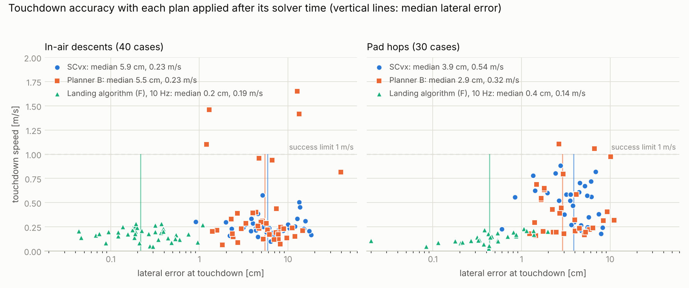

# The landing algorithm for the GTPL lander

This is the guidance algorithm this repository recommends for our vehicle, stated as simply as it can be: the one
piece of mathematics that makes the problem easy, the algorithm that follows from it, what is proved about it, and
how to run it. Everything else in the repository is background.

| | |
|---|---|
| Proof | [`math/10-landing-proof.md`](math/10-landing-proof.md) |
| Code | [`solver/gtpl_guidance/landing.py`](solver/gtpl_guidance/landing.py) (entry point), `fcg.py` (the program), `flat.py` (the formulas) |
| Benchmarks against successive convexification | [`solver/RESULTS-FLAT.md`](solver/RESULTS-FLAT.md) |
| Why exact lossless convexification is still impossible | [`AUDIT-2026-11.md`](AUDIT-2026-11.md) |

## 1. The simplification

Our vehicle steers by tilting one engine. Tilting the engine turns the vehicle, but it also pushes it sideways, so
position and attitude are tangled together. That tangle is why 6-DoF landing is normally solved by iterating
(successive convexification).

**There is one point on the vehicle that the sideways push does not move: the centre of percussion.** It sits on the
body axis a distance

    ε = J_t / (m L) ≈ 1.35 m

above the centre of mass (J_t transverse inertia, m mass, L distance from the gimbal to the centre of mass). Hit a
bat at the right spot and the handle does not jerk; this is the same point. If y is the position of that point and b
is the unit vector along the body, then exactly

    y″ = f b − g,        f = (axial thrust)/m − ε |ḃ|².

Read this as: **the centre of percussion moves like a point mass whose thrust always points along the body.** The
gimbal does not appear. Three things follow.

1. **The attitude is not a separate unknown.** The body points along y″ + g. Choose the path y(t) and the attitude,
   the body rate, the gimbal angle and the throttle all follow by differentiating y (formulas in section 3). The
   whole flight is described by one curve in space.
2. **The dynamics are linear.** Any smooth curve y(t) with y″ + g pointing upward is a flight the vehicle can make.
   There is nothing to linearise and nothing to iterate.
3. **Start and end conditions are linear.** "Start at this position, velocity, attitude, body rate and gimbal
   deflection" and "arrive at the pad at rest, upright, not rotating, gimbal centred" are linear equations in y and
   its derivatives at the two ends.

What is left is the actuator limits (throttle range, gimbal angle, tilt). They are not convex in y, so the algorithm
uses slightly stricter versions that are. This is the only approximation, and it errs on the safe side: a plan that
satisfies the stricter limits satisfies the real ones.

## 2. The algorithm

**Inputs.** The state estimate (position, velocity, attitude, body rate, mass), the current gimbal deflection, and the
landing point. No initial guess, no previous solution, no tuning weights.

**Step 1, once: pick the time of flight.** Bisect on t_f for the smallest value at which the program of step 2 is
feasible, and add 0.25 s. (About 10 solves, under a second here. Done during the hover before descent.)

**Step 2, at every guidance tick (10 Hz): solve one convex program.** The unknown is the curve y(t) from now to
touchdown, a quintic spline with 63 coefficients. The program is a second-order cone program, the type Clarabel
already solves in the flight code. It is the same program every time with new numbers: current state, time to go.

**Step 3, at every control tick: read off the reference.** Evaluate y and its derivatives at the current time and
apply the formulas of section 3. This gives the position, velocity, attitude, body rate, throttle and gimbal angle
the tracking controller should follow. It is closed form, so it can be evaluated at any instant.

**If a solve fails** (infeasible, or the plan fails the slew-rate check), in this order: drop the "arrive in hover"
condition; allow 0.25, 0.5 or 1.0 s more flight time; otherwise keep following the previous plan, which is still
valid.

That is the whole algorithm. There is no outer loop, so there is no convergence to wait for and no iteration budget
to tune.

## 3. The formulas

**From the curve to the vehicle (the flat map).** Let u = y″ + g e₃ (e₃ is up), u′ = y‴, u″ = y⁗, and
P = I − b bᵀ. Then

| quantity | formula |
|---|---|
| body axis | b = u / ‖u‖, with f = ‖u‖ |
| body rate | ḃ = P u′ / f |
| angular acceleration | P b″ = P(u″ − 2 (b·u′) u′ / f) / f |
| axial thrust per unit mass | a = f + ε ‖ḃ‖² |
| gimbal angle δ | tan δ = ε ‖P b″‖ / a |
| throttle | T = m √(a² + ε² ‖P b″‖²) |
| mass | m(t) = m₀ exp(−α ∫₀ᵗ T/m) |
| centre of mass | r = y − ε b, v = y′ − ε ḃ |

**The convex program.** On each of the 16 spline spans, y″, y‴ and y⁗ are polynomials. Their Bezier control points
give four triples (U, U₁, U₂) per span that bracket (u, u′, u″) over the whole span, and all triples are linear in
the 63 coefficients. With p the vertical component of U, the program is:

    minimise    fuel bound  =  α · ∫ σ

    start       y(0) = r₀ + ε b₀,   y′(0) = v₀ + ε ḃ₀,
                u(0) along b₀,   u′(0) and u″(0) matching the current body rate and gimbal deflection
    end         y(t_f) = pad + ε e₃,   y′(t_f) = 0,   u, u′, u″ vertical at t_f,   u_z(t_f) = g  (arrive in hover)

    on every control triple:
      tilt          ‖U_xy‖ ≤ tan(20°) · p
      min throttle  p ≥ 440 N / m
      gimbal        ε · ( ‖U₂ − k e₃‖ + sin(20°)·|k| + ‖U₁‖² / p )  ≤  tan(10°) · (2φp − φ²)
      max throttle  σ ≥ ‖( ‖U‖ + ε‖U₁‖²/(p·L_b) ,  ε·(gimbal bracket)/L_b )‖,     σ ≤ 920 N / m

k is a free scalar per triple and σ is the bound on thrust per unit mass. The mass m in the throttle rows is
bracketed by two linear functions of the unknowns (proof, §8). The exact rows, including the mass bracket and the soft
altitude and glide-slope constraints, are in `fcg.FCG.solve`.

**Constants for our vehicle.**

| symbol | value | meaning |
|---|---|---|
| ε | 1.35 m | centre-of-percussion offset, J_t/(mL) = 63.6/(80 × 0.589) |
| throttle | 440 to 920 N | planning range, inside the physical 400 to 1000 N |
| gimbal | 10° | planning limit, inside the physical ±15° |
| tilt | 20° | maximum body tilt |
| φ | 7.5 m/s² | where the gimbal row is exact; any positive value is safe |
| L_b | 440 N / m₀ ≈ 5.5 m/s² | lower bound on thrust per unit mass |
| α | 5.66 × 10⁻⁴ kg/(N s) | mass flow per newton (Isp 180 s) |
| spans | 16 | 63 spline coefficients |

The margins between planning and physical limits are left for the tracking controller.

## 4. What is proved

> **Theorem F.** Every curve y that satisfies the convex program gives, through the formulas of section 3, a throttle
> and gimbal history under which the vehicle model
> - starts from the given position, velocity, attitude, body rate and gimbal deflection,
> - reaches the pad at rest, upright, not rotating, with the gimbal centred,
> - keeps the throttle within 440 to 920 N, the gimbal within 10° and the tilt within 20° **at every instant**, not
>   only at grid points,
> - and burns no more fuel than the program's objective.

The proof is six short lemmas in [`math/10-landing-proof.md`](math/10-landing-proof.md). Each is elementary, and each
is tied to a test in `solver/tests/test_flat.py`. The centre-of-percussion identity itself is machine-checked in Lean
(`TVC.cop_identity`).

Checked numerically as well:

- **Exactness.** Fed only the planned throttle and gimbal commands, with no feedback, the full nonlinear rigid-body
  simulation lands within 23 nanometres of the target (16 flights, some starting tilted and rotating).
- **Soundness.** 300 random problems, each solved with two reference settings; 458 of the 600 solves were feasible
  and no plan violated a limit at any of 1201 instants.

**Not covered by the theorem:** gimbal slew rate and throttle slew rate (checked on every plan; a plan that fails is
not flown), the altitude floor and glide slope between sample points, and everything outside the model: actuator lag,
wind, sensor error, and the assumption that ε stays constant as propellant burns (1 % variation over a descent in the
simulator's mass table; to be confirmed on the real vehicle).

## 5. What it gives up

This is **not** lossless convexification. That remains impossible for our vehicle: no convex program can accept
exactly the landings that are flyable, because the set of flyable landings is not convex
([`AUDIT-2026-11.md`](AUDIT-2026-11.md)). The algorithm sits on the safe side of that line. It accepts only flyable
landings, and it turns down a thin band of landings that are flyable only by tilting hard to throw thrust away.

| what it costs | how much |
|---|---|
| fuel, at the same time of flight | +0.10 % on average, +0.28 % at worst, against the best 6-DoF plan found by planner B and SCvx |
| shortest possible flight, in-air descents | 0.04 to 0.22 s longer than the true minimum |
| shortest possible flight, 4 s pad hops | up to 0.4 s longer |

When it cannot find a plan it says so. It never returns a plan the vehicle cannot fly.

## 6. Measured performance

Same simulator, tracker, disturbances and cases for every planner: full rigid body, wind and gusts, 2 % thrust noise,
5 % Isp error, gimbal misalignment. Each plan is applied only after the time its solver took, and each planner
replans as fast as it can sustain. Median / 95th percentile / worst case.

| 40 in-air descents | successive convexification | this algorithm |
|---|---|---|
| landed within limits | 40/40 | 40/40 |
| lateral error at touchdown | 5.9 / 15.7 / 18.3 cm | **0.2 / 0.8 / 1.1 cm** |
| touchdown speed | 0.23 / 0.46 / 0.58 m/s | **0.19 / 0.28 / 0.29 m/s** |
| tilt at touchdown | 0.21 / 0.70 / 1.23° | **0.11 / 0.30 / 0.63°** |
| fuel | 3.58 kg | **3.52 kg** |
| convex programs per plan | 20 | **1.4** |
| solver time per replan, mean / worst | 1.05 / 4.9 s | **0.031 / 0.39 s** |
| gimbal travel over the flight | 156° | **45°** |
| throttle travel over the flight | 2800 N | **1130 N** |

| 30 pad hops | successive convexification | this algorithm |
|---|---|---|
| landed within limits | 30/30 | 30/30 |
| lateral error at touchdown | 3.9 / 7.6 / 8.2 cm | **0.4 / 1.4 / 2.0 cm** |
| touchdown speed | 0.54 / 0.81 / 0.88 m/s | **0.14 / 0.22 / 0.23 m/s** |
| tilt at touchdown | 0.96 / 2.46 / 2.54° | **0.20 / 0.62 / 0.87°** |
| fuel | **1.46 kg** | 1.54 kg (+5 %) |
| solver time per replan, mean / worst | 0.35 / 2.4 s | **0.017 / 0.052 s** |

Where it does not win: hops cost 5 % more fuel. It flies them about 0.1 s longer on average and had to extend the
flight time during replans in 6 of the 30 runs. If every planner is given
zero computation time and the same 1 Hz replan rate, lateral accuracy is a tie (3.1 cm each), so the accuracy gain
comes from being fast enough to replan ten times a second. Full tables, ablations and a four-times-slower computer
are in [`solver/RESULTS-FLAT.md`](solver/RESULTS-FLAT.md).



## 7. Using it

```python
import numpy as np
from gtpl_guidance.landing import LandingGuidance

guide = LandingGuidance(target=[0, 0, 1.5])     # CG height when standing on the pad
# x = [position(3), velocity(3), quaternion(4, scalar first, body to world), body rate(3), mass]
guide.update(t, x, actuators=(gimbal_theta, gimbal_phi, thrust))   # every 0.1 s
ref = guide.reference(t)                         # every control tick
# ref: position, velocity, body_axis, body_axis_rate, throttle, gimbal_angle, thrust_world, mass, time_to_go
```

Run the worked example and the tests:

```bash
cd solver
```
```bash
uv venv --python 3.12 .venv && uv pip install --python .venv/bin/python numpy scipy cvxpy clarabel ecos casadi matplotlib pytest
```
```bash
OMP_NUM_THREADS=1 .venv/bin/python scripts/example_landing.py
```
```bash
OMP_NUM_THREADS=1 .venv/bin/python -m pytest -q
```

The example plans a descent from 50 m and 22 m off the pad, prints the plan, then flies it with disturbances:

```
time of flight 8.19 s, planned fuel 3.706 kg, 1 convex program, 45 ms in the solver

  t [s]   CG position [m]            tilt [deg]  throttle [N]  gimbal [deg]
   0.00   ( 10.00,  20.00,  50.00)     0.00       440.7        0.00
   2.05   (  9.61,  19.23,  35.77)    18.24       713.2        2.60
   4.09   (  5.07,  10.13,  16.58)     0.62       913.4        0.26
   6.14   (  0.62,   1.23,   4.98)    11.83       915.9        0.81
   8.19   (  0.00,   0.00,   1.50)     0.00       738.4        0.00

closed loop: touchdown 0.3 cm from the target at 0.20 m/s, tilted 0.12 deg, fuel 3.47 kg, 76 plans
```

## 8. Before it flies

1. **Measure ε.** The algorithm assumes the centre of percussion stays put as propellant burns. Compute
   J_t/(m L) from measured mass properties at full, half and empty propellant. If it moves by more than a few
   percent, plan with its value at the current mass (the code already does this at each replan).
2. **Port the program to Rust.** One SOCP with the cone types `rust_lossless` already uses. Layout, sizes and timing
   are in [`solver/PORTING.md`](solver/PORTING.md) §6.
3. **Feed the tracker the full reference.** The flight MPC currently tracks thrust magnitude only and holds the
   attitude reference at identity. Give it the planned attitude, rate and gimbal feed-forward.
4. **Fix the MPC's vehicle model.** Its inertia and lever arm overstate angular authority about 4.6 times
   (`context/vehicle.md`). This matters whatever guidance is used.
5. **Check the gimbal's real slew rate.** Slew limits are checked per plan, not enforced inside the program. If the
   real gimbal is slower than 100°/s, turn on the slew rows (`FCG(slew=True)`) and re-run the Monte Carlo.
6. **Run it in `rust_rocket_sim`.** Every number above comes from this repository's Python simulator.
