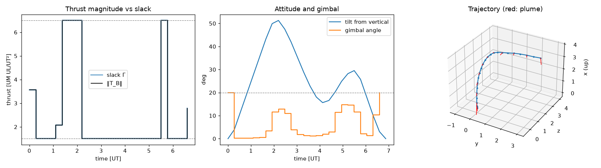

# 6-DOF lossless convexification for powered descent

## Background

Lossless convexification (LCvx) is what makes the 3-DOF solver in
`guidance/LosslessConvexification` work. The engine can't throttle below `T_min`, so the allowed
thrust vectors form a hollow shell, `T_min ≤ ‖T‖ ≤ T_max`, which is not convex. LCvx replaces it
with `‖T‖ ≤ Γ` and `T_min ≤ Γ ≤ T_max`, and burns propellant at `αΓ` instead of `α‖T‖`. That
problem is convex, and Açıkmeşe and Ploen proved that, under mild conditions, its optimum has
`‖T‖ = Γ`, so it also solves the real problem. "Lossless" means that equality holds.

Their proof is for a point mass. In 6-DOF the engine is attached to the body, so the thrust
direction depends on attitude, and the attitude dynamics (quaternion kinematics, the gyroscopic
`ω × Jω` term) are nonlinear. Nobody knows an exact convex form of those dynamics, so there is no
lossless convexification of the whole 6-DOF problem. The standard 6-DOF method is successive
convexification (SCvx): repeatedly linearize around the last solution and solve the resulting
convex problem. Szmuk, Reynolds and Açıkmeşe ([arXiv:1811.10803](https://arxiv.org/abs/1811.10803))
don't use LCvx for the thrust bound. They linearize `‖T_B‖ ≥ T_min` around the previous iterate
(their eq. 35) and burn propellant at `α‖T_B‖`.

This folder shows that the LCvx slack still works when the dynamics are the full nonlinear 6-DOF
rigid body. SCvx still handles the dynamics, but the thrust bound becomes exact convex constraints
instead of a linearization. The proof is checked by Lean 4 and Mathlib, and a 6-DOF solver uses
the relaxation on Szmuk's test vehicle. A continuous-time version of the idea already exists;
"Prior work" below says what is new here.

## The result

The setup is the discrete problem the solver solves. The flight is split into `N` intervals, and
the body-frame thrust `u_k` and slack `Γ_k` are held constant over each one. Call node `k`
*lossy* if `‖u_k‖ < Γ_k`: the relaxation isn't tight there, and the real engine couldn't produce
that thrust.

The free-final-time theorem, `sixDOF_free_time` in [lean/LCvx/SixDOF.lean](lean/LCvx/SixDOF.lean),
says:

> At a local minimum of the relaxed 6-DOF problem, take any set of lossy nodes where the gimbal
> limit isn't active. The thrusts at those nodes cannot steer the terminal conditions in every
> direction, even to first order.

The other hypotheses: `α > 0`, `T_min > 0`, the time of flight strictly inside its bounds,
positive mass at every node, and the remaining path constraints (glide slope, tilt, angular rate,
dry mass) not active.

The proof is by contradiction. Suppose the lossy thrusts could steer the terminal state in every
direction. Each of them has room to move, since it is strictly inside its `‖u‖ ≤ Γ` ball and
inside the gimbal cone, and the cost (propellant) doesn't depend on it. So land slightly sooner,
which saves propellant, and use the lossy thrusts to put the terminal state back. That gives a
cheaper feasible point arbitrarily close to the original one, so the original was not a local
minimum. The "put the terminal state back" step is Mathlib's surjective-derivative open mapping
theorem (`HasStrictFDerivAt.map_nhds_eq_of_surj`). It only needs the dynamics to be C¹, so it
covers 6-DOF.

There are 10 terminal conditions (position, velocity, upright attitude, pitch and yaw rate) and
each node has 3 thrust components, so steering all 10 takes at least 4 nodes. The corollary
`card_lossy_lt` turns the theorem into a count: if every set of 4 nodes can steer the terminal
state, at most 3 gimbal-inactive nodes are lossy. With active path constraints the same count
applies to the tail of the flight described below.

With a fixed time of flight, `sixDOF_fixed_time` gives a weaker conclusion: if the lossy thrusts
can steer the terminal state, every `Γ_k` equals `T_min`. That is the known long-horizon failure
of LCvx: with more time than it needs, the relaxed vehicle can idle below minimum thrust. Free
final time rules it out because landing sooner is always cheaper.

Path constraints (glide slope, tilt, angular rate, dry mass) need care, because the theorems
above require all of them to have slack at the solution. `sixDOF_tail` and `sixDOF_ptr_tail`
relax that using causality: a thrust at node `j` cannot change the state at any earlier node
(`traj_eq_of_agree`, and `fderiv_traj_eq_zero` for the linearized dynamics). So if the last active
path constraint is at node `m`, the argument still runs with lossy nodes and slack changes from
node `m` on, and those perturbations leave every constraint up to `m` exactly as it was. The
conclusion is the fixed-time one restricted to that tail of the flight: if the lossy thrusts
there can steer the terminal conditions, every slack from node `m` on sits at `T_min`.

An active constraint can also be held as an equality instead: move it into `F`. The feasible set
only shrinks and still contains the optimum, so the optimum stays a local minimum, and the
constraint no longer needs slack. The price is that the lossy thrusts must steer its value too.
`sixDOF_fold` and `sixDOF_ptr_fold` do this for active path constraints after the split node `m`
(so nodes before the last active constraint can be covered), and for the gimbal limit at a lossy
node (as long as its thrust is nonzero, where `cos δ ‖u‖ − u₀` is smooth).

[lean/LCvx/Examples.lean](lean/LCvx/Examples.lean) has three small problems that check the
hypotheses are the right ones:
- **All hypotheses hold together.** Reach `u = 0` with thrust bounds `[1, 2]` and cost `Γ`. The
  relaxed optimum `u = 0, Γ = 1` is lossy, the theorem gives `Γ = T_min` as it should, and Lean
  proves the original problem has no feasible point. So with a fixed horizon the "every slack at
  `T_min`" branch really happens and can't be dropped.
- **The steering hypothesis is needed.** Pin `Γ = 3/2` through `F`, which the thrust doesn't
  enter. Every other hypothesis holds, and the minimizer `u = 0, Γ = 3/2` is lossy with its slack
  strictly above `T_min`. So "the lossy thrusts can steer `F`" doesn't follow from the rest. It is
  a property of each solution, which is why the checks below test it.
- **Active path constraints really can break losslessness.** Two nodes of a scalar integrator,
  a state bound `u₀ ≤ 1/2` that is active at the optimum, and the terminal condition
  `u₀ + u₁ = 5/2`. The minimizer `u = (1/2, 2), Γ = (1, 2)` is lossy at node 0 and not degenerate,
  and the lossy thrust can steer the terminal condition. The only hypothesis that fails is slack
  in the path constraint, and the original problem has no feasible point. So no theorem can
  guarantee the nodes before an active path constraint without steering that constraint too. The
  survey's continuous-time results need special structure for state constraints for the same
  reason.

The general version, for any C¹ dynamics and any cost that ignores thrust direction and grows
with `Γ`, is in [lean/LCvx/Basic.lean](lean/LCvx/Basic.lean). That file also proves
`isMinOn_original`: a lossless optimum of the relaxed problem is an optimum of the original
nonconvex one.

The Lean statement:

```lean
theorem sixDOF_free_time (D : Data N ℝ Y) (htof : D.tof = id) (hα : 0 < D.p.α) (hN : N ≠ 0)
    (hM : D.M ≠ 0) (hTmin : 0 < D.Tmin) (hterm : ContDiff ℝ 1 D.term)
    {z : Dec N Thrust ℝ} (hz : z ∈ D.toProblem.relaxed)
    (hmin : IsLocalMinOn D.toProblem.cost D.toProblem.relaxed z)
    (hother : D.other ∈ 𝓝 z) (hs : 0 < z.2.2)
    (hmass : ∀ k : Fin N, 0 < (traj D.p D.M D.tof D.x₀ z (k + 1)).1)
    (L : Finset (Fin N)) (hL : ∀ j ∈ L, ‖z.1 j‖ < z.2.1 j ∧ Real.cos D.δ * ‖z.1 j‖ < z.1 j 0) :
    ¬ Function.Surjective (fderiv ℝ D.toProblem.F z ∘L lossyIncl L)
```

`D.toProblem.F` means "integrate the 6-DOF dynamics with RK4, then read off the terminal
conditions". It is built from `field`, the same equations as the Python model, with the same
substeps. `lossyIncl L` moves the thrust at the nodes in `L` and nothing else. Nothing is left as
`sorry`, and `#print axioms` lists only Lean's three standard axioms.

### Applying it to what the solver returns

The theorems above assume a local minimum of the nonlinear problem, which SCvx does not hand you.
A converged PTR iterate is a point that solves its own convex subproblem: fuel plus a
virtual-control penalty plus a trust-region penalty centred on that same point, subject to the
dynamics linearized there. [lean/LCvx/Fixpoint.lean](lean/LCvx/Fixpoint.lean) closes the gap in
two steps. First, the trust-region penalty has zero gradient at its own centre, so on a convex
problem it can be dropped without changing the minimizer (`isMinOn_of_isMinOn_add`). Second, the
converged point then minimizes fuel over the linearized relaxed problem
(`Problem.isMinOn_of_fixed_point`), and the theorem applies there. The linearized terminal map
has the same derivative as the real one, so the conclusion is about the real 6-DOF dynamics.

`sixDOF_ptr_free_time`, `sixDOF_ptr_fixed_time` and `sixDOF_ptr_tail` in `SixDOF.lean` state
this for 6-DOF. Their hypotheses are what the solver reports: the last subproblem returned its
own reference, its path constraints are inactive there (or, for the tail version, inactive after
node `m`), and its fuel term is the first-order expansion of `-m_N`.
That last point is the formula in `Data.linProblem`, and `Data.cost_sub_linProblem_cost` proves
it differs from `-m_N` by a product of two first-order changes.

## Numerical check

[solver/sixdof_lcvx.py](solver/sixdof_lcvx.py) is a 6-DOF PTR (penalized trust region SCvx)
solver with Szmuk's model and parameters and the LCvx slack in place of their linearized lower
bound. [solver/check_lossless.py](solver/check_lossless.py) solves each case and checks it.

| case | t_f | landed mass | max `Γ − ‖T‖` | nodes at `T_min` | active path constraints | re-integration error | iterations |
| --- | --- | --- | --- | --- | --- | --- | --- |
| baseline, free t_f | 6.869 | 1.43734 | 1.3e-9 | 18 of 25 | rate limit at 16 nodes | 3.0e-7 | 91 |
| `loose_rate`: rate limit 90°/UT, free t_f | 5.568 | 1.47383 | 7.9e-9 | 17 of 25 | none | 3.0e-7 | 57 |
| t_f fixed at 7.5 | 7.5 | 1.42766 | 2.7e-9 | 19 of 25 | rate limit at 4 nodes | 2.5e-7 | 379 |
| t_f fixed at 12 | 12 | 1.26406 | 1.0e-9 | 22 of 25 | rate limit at 1 node | 1.0e-6 | 2128 |

At the nodes counted under "nodes at `T_min`", the relaxed problem was free to thrust below what
the engine can do, and it didn't.

The re-integration error comes from running the converged controls through scipy's adaptive
RK45 at tight tolerance, so the trajectory satisfies the real dynamics and not just the
discretization. Each converged case also passes two consistency checks. Re-solving its last
convex subproblem without the trust-region penalty gains at most 1.3e-8 landed mass, so the
converged point really is a fixed point. And the solver's subproblem fuel term matches the Lean
formula in `Data.linProblem` to within 5e-15 on random perturbations.

The table below checks the tail theorem's hypotheses. `m` is the last node with an active path
constraint, and the script tests every set of 4 thrust nodes from `m` on. Where all of them can
steer the 10 terminal conditions and some tail node has `Γ > T_min`, the theorems allow at most
3 lossy (gimbal-inactive) nodes in the tail. Rank is decided at 1e-9 relative. The worst set in
any case has a smallest-to-largest singular value ratio of about 8e-8, small but well above
rounding error.

| case | last active node `m` | 4-node sets tested in the tail | all can steer | what is guaranteed |
| --- | --- | --- | --- | --- |
| baseline | 23 | 0 (only nodes 23 and 24) | n/a | nothing |
| `loose_rate` | none | 12,650 | yes | at most 3 lossy nodes, whole flight |
| t_f fixed at 7.5 | 5 | 4,845 (nodes 5 to 24) | yes | at most 3 lossy nodes in 5 to 24 |
| t_f fixed at 12 | 2 | 8,855 (nodes 2 to 24) | yes | at most 3 lossy nodes in 2 to 24 |

These rank tests are proved, not just computed. [solver/certify_rank.py](solver/certify_rank.py)
re-runs the exact RK4 shooting map at each reported solution in 50-digit interval arithmetic
(outward rounding, the vector field written as in `SixDOF.lean`), takes an approximate inverse `X`
of each node set's matrix, and bounds `‖M X − I‖ < 1` over the whole enclosure, which proves full
rank. Every set in the table above certifies: 12,650 of 12,650 on `loose_rate`, 4,845 of 4,845
for t_f = 7.5, 8,855 of 8,855 for t_f = 12, and every set behind the baseline's folded bounds
below. The worst bound is 2e-8.

The solver found no lossy node in any case.



## Scope

Everything in "The result" is proved in Lean. The theorems are exact statements with explicit
hypotheses, and these are their limits as mathematics:

- They are about local minima (or converged SCvx iterates). The 6-DOF problem is nonconvex and
  can have several, and the theorems say nothing about which one SCvx converges to.
- Intermediate SCvx iterates can be very lossy (in one run, `Γ ≈ 3` with `‖T‖ ≈ 0`). Only the
  converged point is covered.
- Active path constraints make the guarantee weaker, not void. Holding them as equalities
  (`sixDOF_fold`) covers nodes before the last one, but a held constraint at node `k` can only be
  steered by thrusts before `k`, so the node count in the bound grows quickly. On Szmuk's
  baseline, where the rate limit is active at 16 nodes as late as node 23, the folded check gives
  at most 3 lossy nodes in 21 to 24, at most 6 in 17 to 24, and only "at most 19 of 20" in 5 to
  24. Nodes 0 to 4 get nothing. On the baseline, losslessness is mostly observed rather than
  guaranteed.
- A lossy node on the gimbal limit is covered by holding the limit as an equality, provided its
  thrust is nonzero (`cos δ ‖u‖ − u₀` is not smooth at `u = 0`). No lossy node appeared in any
  case, so this branch is only exercised in Lean.
- Whether a set of nodes can steer the terminal state is a property of each solution. It can't
  be proved in general because it isn't true in general: the second example in `Examples.lean`
  has every other hypothesis and fails losslessness when steering fails. For the reported
  solutions it is proved with interval arithmetic (`certify_rank.py`).
- Nothing is checked between nodes, as usual for this discretization. With thrust held constant
  over each interval, though, lossless at the nodes means lossless for the whole flight.

The numerical demonstration is separate from the proof. It shows the theorems at work on real
solutions, and has limits of its own:

- A floating-point solver output is never an exact optimum of a nonconvex problem. The solver
  stops at a 1e-6 step tolerance and classifies constraints as active at 1e-6. So "this reported
  trajectory satisfies the theorem's hypotheses" holds to that tolerance. That is a property of
  numerical optimization, not of the theorem, and certifying an exact optimum nearby would need a
  verified nonlinear solver. Running `loose_rate` 2,000 iterations further (step down to 1.6e-7)
  leaves the landed mass unchanged to 9 digits and the largest `Γ − ‖T‖` at 8e-9.
- The solver isn't robust. It needs a hand-picked trust-region weight per case: 0.05 for the
  baseline, 0.2 for `t_f = 7.5`, and 0.5 for `t_f = 12`, which then takes about 2,100
  iterations (with 0.05 or 0.1 it falls into a 2-cycle). An adaptive weight (the SCvx ratio test)
  did worse on these cases, so it isn't in the code.
- The setup departs from Szmuk et al. in two places. Read as `tan(75°)‖r_yz‖ ≤ r_x`, their 75°
  glide slope excludes the initial position of their own case study (`[5.33, 4.5, 0]`), so this
  uses 20°. The final roll angle is left free, because the vehicle is axisymmetric and the gimbal
  can't make roll torque.

## Prior work

The closest discrete-time LCvx result is Luo, Echigo and Açıkmeşe
([arXiv:2410.09748](https://arxiv.org/abs/2410.09748)). It covers linear time-invariant dynamics,
shows that after a small perturbation of the dynamics the relaxation fails at no more than
`n_x − 1` nodes, and leaves broader problem classes for future work. Its proof uses Lagrange
multipliers. The argument here uses the open mapping theorem instead and doesn't need the
dynamics to be linear.

The idea that the slack relaxation survives nonlinear dynamics is not new. Blackmore, Açıkmeşe
and Carson (ACC 2012, and Systems & Control Letters 2012) proved it in continuous time for
dynamics `ẋ = f(t, x, u, g_c(u))`, with the slack in the dynamics, as here. I read the ACC
version from the [JPL Open Repository](https://hdl.handle.net/2014/42802). Their Theorem 1 takes
the optimal solution of the relaxed problem and argues through Pontryagin's maximum principle
along it, with free final time ruling out the degenerate case (as in `sixDOF_free_time`). Its
Condition 1 asks for the costate system `[−∇ₓf, ∇ᵤf]` to be totally observable on every
subinterval, for every feasible trajectory. The survey by Malyuta et al.
([arXiv:2106.09125](https://arxiv.org/abs/2106.09125)) calls this generally quite difficult to
check. The paper verifies it only for two structures (its Corollaries 1 and 2), which need about
as many controls as states or a first-derivative rank condition. Those cover 3-DOF landing with
drag, nonlinear gravity and mass depletion, but not 6-DOF, with 3 thrust components against 13
non-mass states.

What this folder adds:
- It works in discrete time, which is what solvers solve.
- It covers local minima and converged SCvx iterates, not only global optima.
- Its condition is a rank test at the actual solution rather than "for every feasible
  trajectory".
- It handles active path constraints through causality.
- It applies all of that to 6-DOF, with every step checked by Lean.

In return, the conclusion is weaker: a bound on how many nodes can be lossy instead of "none".

A recent paper by Upadhyay, Ganguly and Chatterjee ([arXiv:2607.12109](https://arxiv.org/abs/2607.12109),
Automatica 2026) also uses LCvx for landing. It works with continuous-time linear 3-DOF dynamics
solved to global optimality, so it does not overlap with the above.

## One convex program instead of SCvx?

`solver/sdp_relaxation.py` tries to skip SCvx by solving one semidefinite program (SDP). It uses a
coarse fixed-time version of the same vehicle, `N = 10`, `t_f = 7.5`, written so every constraint
is at most quadratic. The attitude is a rotation matrix stepped with the Cayley map. It then takes
Shor's relaxation: each product `x_i x_j` becomes an entry of a PSD matrix, one per pair of
neighbouring nodes. If every matrix came out rank one, the answer would be the proven global
optimum. It doesn't:

| | final mass `m_N` |
|---|---|
| SDP upper bound | 1.557 |
| IPOPT local optimum on the same discrete problem | 1.316 |
| trivial bound from `Γ ≥ T_min` | 1.625 |

No block is close to rank one: `λ₂/λ₁` is 0.25 to 0.51 in every block. The bound barely improves
on the trivial one. Holding the mass constant leaves it just as loose, so the attitude coupling is
the cause, not the mass. The next level of the moment hierarchy would need 1770×1770 PSD blocks per
pair of nodes.

This matches the GTPL `lossless-work` repo, which proves in Lean that no convex program whose
initial position and velocity enter convexly can be lossless for every initial condition of the
5-DOF or kinematic 6-DOF lander. That proof does not rule out a relaxation that happens to be
tight for one particular initial condition, which is what this experiment looked for.

## Running it

The Lean proof needs [elan](https://github.com/leanprover/elan), Lean's version manager, on your
PATH. The first command downloads about 5 GB of prebuilt Mathlib:

```bash
cd lean && lake exe cache get && lake build
```

Then check that no proof was skipped. Every line should list only `propext`,
`Classical.choice` and `Quot.sound`; a `sorry` would show up as `sorryAx`:

```bash
cd lean && lake env lean AxiomsCheck.lean
```

The interval-arithmetic proof of a solution's rank tests, for example `loose_rate` with every set
of 4 nodes from node 0 on:

```bash
cd solver && ../.venv/Scripts/python certify_rank.py loose_rate 0 4
```

The solver and checks, from this folder (results go to `solver/results/`):

```bash
python -m venv .venv && .venv/Scripts/python -m pip install -r solver/requirements.txt
```

```bash
cd solver && ../.venv/Scripts/python check_lossless.py
```

## Layout

- `lean/LCvx/Core.lean`: the perturbation lemma, built on the open mapping theorem.
- `lean/LCvx/Basic.lean`: the relaxed and original problems for any C¹ dynamics, the two LCvx
  theorems, the lossy-node count, and exactness.
- `lean/LCvx/Fixpoint.lean`: from a converged SCvx iterate to a minimizer of the linearized
  relaxed problem.
- `lean/LCvx/SixDOF.lean`: the 6-DOF vector field, the RK4 discretization, a proof that the
  shooting map is C¹ wherever the mass is positive, the 6-DOF theorems, their versions for
  converged SCvx iterates, and the tail and folded versions for active constraints.
- `lean/LCvx/Examples.lean`: three small problems. In one every hypothesis holds and the
  relaxation is lossy (the theorems aren't vacuous, and the fixed-time degenerate case is real).
  In the second only the steering hypothesis fails, and in the third only slack in a path
  constraint fails; losslessness fails with each.
- `solver/certify_rank.py`: interval-arithmetic proof of the steering rank test for a reported
  solution.
- `solver/sixdof_lcvx.py`: model, exact RK4 Jacobians, PTR solver.
- `solver/check_lossless.py`: cases and checks.
- `solver/sdp_relaxation.py`: the one-shot SDP attempt above, checked against IPOPT.
