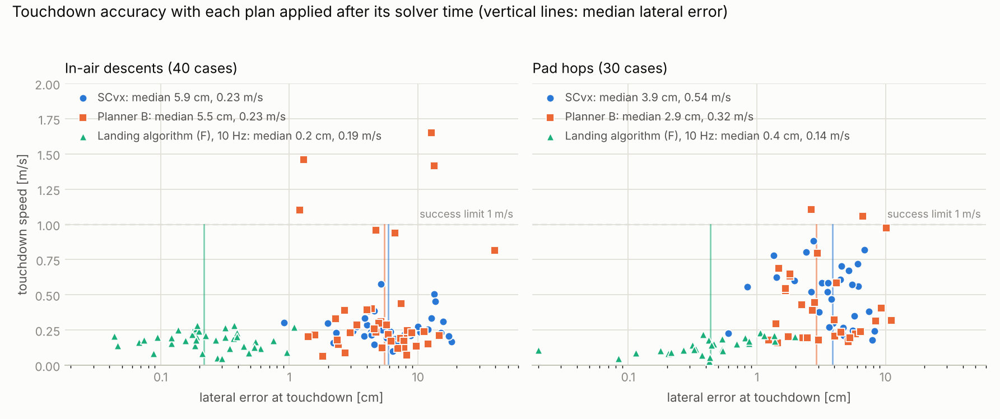

# Results: the landing algorithm (planner F) against successive convexification and planner B

Generated 2026-11-10. The algorithm is described in [`../LANDING-ALGORITHM.md`](../LANDING-ALGORITHM.md) and proved
sound in [`../math/10-landing-proof.md`](../math/10-landing-proof.md). Here it is called **F**. It is compared with

- **S**: standard 6-DoF successive convexification (`gtpl_guidance/scvx6dof.py`, unchanged from RESULTS-SCVX.md),
- **B**: attitude-aware convex guidance (`gtpl_guidance/aacg.py`, unchanged).

All three use the same vehicle, planning limits (throttle 440 to 920 N, gimbal 10°, tilt 20°, glide slope 10° in the
air and none for hops), plant, tracker, disturbances, cases and random seeds as RESULTS.md and RESULTS-SCVX.md. B and
S were re-run on this machine alongside F (4 cores, 3 or 4 jobs at a time, single-threaded BLAS). Solver times are
Clarabel's own.

F is the shipped configuration unless a row says otherwise: one fixed SOCP per plan with 16 spline spans, default
references, the arrive-in-hover terminal condition with fallback, and no information carried from one plan to the next.

## Summary

| | S (SCvx) | B | F |
|---|---|---|---|
| convex programs per plan, open loop | 25 to 35 | 9 to 37 | **1** |
| solver time per plan, open loop (median) | 1.30 s | 0.79 s | **0.046 s** |
| fuel against the best of B and S, same final time | reference | reference | +0.10 % mean, +0.28 % max |
| minimum final time, in-air | reference | reference | +0.04 to +0.22 s |
| plan holds its limits between grid points | checked on a finer grid | checked on a finer grid | **by construction** (Theorem F) |
| open-loop replay error in its own model | 2 nm to 10 µm | 0.1 to 1.3 mm | **at most 23 nm** |
| open-loop replay error against the plant's mass table (median) | 0.45 m | 0.43 m | **0.03 m** |
| closed loop with solver time counted, in-air: lateral error, median / p95 | 5.9 / 15.7 cm | 5.5 / 13.4 cm | **0.2 / 0.8 cm** |
| same, touchdown speed, median / p95 | 0.23 / 0.46 m/s | 0.23 / 1.42 m/s | **0.19 / 0.28 m/s** |
| same, landings within limits (in-air, hops) | 40/40, 30/30 | 36/40, 28/30 | 40/40, 30/30 |
| needs an initial trajectory, trust region, penalty weights, iteration budget | yes | yes | **no** |

F does not win on fuel for pad hops (+5 %), on minimum flight time, or, if every planner is given zero computation
time and the same replan rate, on lateral accuracy (a tie). Section 9 lists every place it is worse.

Reproduce (from `solver/`, with the environment of README.md):

```bash
OMP_NUM_THREADS=1 .venv/bin/python scripts/run_openloop_flat.py
```
```bash
OMP_NUM_THREADS=1 .venv/bin/python scripts/replay_flat.py
```
```bash
OMP_NUM_THREADS=1 .venv/bin/python scripts/run_hop_flat.py
```
```bash
OMP_NUM_THREADS=1 .venv/bin/python scripts/run_mc_flat.py --scenario inair --n 40 --workers 3 --methods B,S,Blat,Slat,Sh,Shlat,Slat4,Fplain,F10plainown,F5x4plainown,F10plain,F10own25,F10,F10hard,F,F0
```
```bash
OMP_NUM_THREADS=1 .venv/bin/python scripts/run_mc_flat.py --scenario hop --n 30 --workers 3 --methods B,S,Blat,Slat,Sh,Shlat,Slat4,Fplain,F10plainown,F5x4plainown,F10plain,F10own25,F10,F10hard,F,F0
```
```bash
.venv/bin/python scripts/report_flat.py && .venv/bin/python scripts/plot_flat.py
```

`report_flat.py` prints every table below from `results/*_flat.json`, `replay_flat.json`, `stress_flat.json` and
`audit_*.json`.

## 1. Open loop: fuel and solver work (8 in-air scenarios)

All three planners at the same final time, B's minimum certified t_f plus 0.5 s, which is where the closed loop
operates. "Lower bound" is the 3-DoF relaxation at that t_f. "F, one SOCP" is a single solve with default references.

| scenario | t_f [s] | lower bound [kg] | B [kg] | S [kg] | F, one SOCP [kg] | F vs best of B, S | SOCPs B / S / F | solver time B / S / F [s] |
|---|---|---|---|---|---|---|---|---|
| S1 | 8.87 | 3.8455 | 3.8455 | 3.8455 | 3.8455 | -0.00 % | 9 / 25 / 1 | 0.08 / 0.63 / 0.046 |
| S2 | 8.89 | 3.8741 | 3.8910 | 3.8908 | 3.9017 | +0.28 % | 37 / 34 / 1 | 1.04 / 1.29 / 0.046 |
| S3 | 7.71 | 3.5313 | 3.5327 | 3.5317 | 3.5318 | +0.00 % | 33 / 35 / 1 | 0.86 / 1.33 / 0.059 |
| S4 | 8.77 | 3.8998 | 3.9071 | 3.9073 | 3.9095 | +0.06 % | 37 / 35 / 1 | 1.10 / 1.35 / 0.045 |
| S5 | 8.02 | 3.7200 | 3.7335 | 3.7331 | 3.7409 | +0.21 % | 27 / 35 / 1 | 0.72 / 1.31 / 0.044 |
| S6 | 8.61 | 4.0083 | 4.0186 | 4.0182 | 4.0256 | +0.18 % | 37 / 35 / 1 | 1.00 / 1.27 / 0.047 |
| S7 | 7.45 | 3.3764 | 3.3772 | 3.3772 | 3.3775 | +0.01 % | 27 / 35 / 1 | 0.67 / 1.30 / 0.046 |
| S8 | 8.46 | 3.7676 | 3.7725 | 3.7724 | 3.7757 | +0.09 % | 21 / 34 / 1 | 0.59 / 1.28 / 0.065 |

F (one SOCP) vs best of B and S: mean +0.10 %, max +0.28 %. Median solver time: B 0.79 s, S 1.30 s, F 0.046 s (B/F = 17x, S/F = 28x).
F with 2 refinement passes: mean +0.09 %, max +0.23 %, SOCPs [2, 3, 2, 2, 3, 3, 2, 2].
All certificates passed: B True, S True, F True.

At a fixed final time the fuel is almost the same for every planner, because the total impulse is fixed by the
boundary conditions. What differs is the work: one SOCP against 9 to 37.

### Minimum final time

Each planner at the shortest final time it can certify. F's restriction costs it a little flight time, and fuel
follows flight time.

| scenario | min t_f: B [s] | min t_f: F [s] | difference [s] | fuel B at its min [kg] | fuel F at its min [kg] | F vs B |
|---|---|---|---|---|---|---|
| S1 | 8.37 | 8.41 | +0.04 | 3.6336 | 3.6522 | +0.51 % |
| S2 | 8.39 | 8.61 | +0.22 | 3.6998 | 3.7935 | +2.53 % |
| S3 | 7.21 | 7.27 | +0.05 | 3.3192 | 3.3412 | +0.66 % |
| S4 | 8.27 | 8.41 | +0.15 | 3.7053 | 3.7636 | +1.58 % |
| S5 | 7.52 | 7.65 | +0.14 | 3.5290 | 3.5900 | +1.73 % |
| S6 | 8.11 | 8.29 | +0.18 | 3.8293 | 3.8964 | +1.75 % |
| S7 | 6.95 | 6.99 | +0.04 | 3.1646 | 3.1835 | +0.60 % |
| S8 | 7.96 | 8.08 | +0.11 | 3.5676 | 3.6174 | +1.40 % |

## 2. Exactness: open-loop replay

The plan's throttle and gimbal commands are fed, with no feedback, to the full quaternion rigid body with depleting
mass (`flatcert.replay`, DOP853 at 1e-13 tolerance). In F's planning model the landing error is pure integration error:

| | position error | velocity error |
|---|---|---|
| 8 scenarios, upright start at rest | 0.01 to 3.3 nm | up to 1.7 nm/s |
| 8 scenarios, start tilted 3° and rotating at 0.036 rad/s | 0.5 to 22.8 nm | up to 11.5 nm/s |

This is for a gimballed engine whose steering force is fully coupled to translation, with mass depletion. It shows
the flat map is the exact inverse of the model, as Lemma 2 of the proof says. It says nothing about model error.

**Model error.** Each planner is exact in its own model and off in the others. B and S freeze J_t and L at their
initial values; F holds the centre-of-percussion offset J_t/(mL) constant. The plant's mass table agrees much better
with F's assumption:

| scenario | B: own model (frozen J, L) | S: own model | F: own model (CoP) | B: plant table | S: plant table | F: plant table |
|---|---|---|---|---|---|---|
| S1 | 1.3e-03 | 1.9e-09 | 7.8e-12 | 0.001 | 0.000 | 0.000 |
| S2 | 3.2e-04 | 9.8e-06 | 3.3e-09 | 0.764 | 0.786 | 0.049 |
| S3 | 1.1e-04 | 4.6e-07 | 2.3e-09 | 0.032 | 0.071 | 0.015 |
| S4 | 2.5e-04 | 4.9e-06 | 2.9e-09 | 0.575 | 0.601 | 0.057 |
| S5 | 5.8e-04 | 5.4e-06 | 5.9e-10 | 0.760 | 0.724 | 0.089 |
| S6 | 3.4e-04 | 6.6e-06 | 9.3e-10 | 0.618 | 0.629 | 0.068 |
| S7 | 3.7e-04 | 5.9e-07 | 1.3e-09 | 0.089 | 0.076 | 0.019 |
| S8 | 2.3e-04 | 1.4e-06 | 3.0e-09 | 0.286 | 0.299 | 0.012 |

F own-model replay: median 1.8e-09 m, max 3.3e-09 m; velocity max 1.7e-09 m/s.
Median plant-table replay error: B 0.430 m, S 0.450 m, F 0.034 m.
F plan peaks over the 8 scenarios: gimbal cone 8.0 deg, gimbal rate 28 deg/s, throttle rate 129 N/s, tilt 15.0 deg, T in [441, 918] N.

The first three columns are each planner in its own model. (F's own-model column was produced by
`run_openloop_flat.py`; the tilted starts above are in `replay_flat.json`.) In the plant-table columns, B and S miss
by about 0.4 m and F by about 0.03 m with no feedback at all. The closed loop removes these errors for every planner,
but the tracker has less to correct when the plan is closer to the plant.

## 3. Pad-hop map: soundness and completeness

Launch from the pad straight up at v0z and land d metres away after exactly 4 s. "Flyable" means the nonconvex IPOPT
reference found a plan (results/hop_map.json).

| v0z [m/s] | d = 0 m | d = 2 m | d = 4 m | d = 6 m |
|---|---|---|---|---|
| 5.0 | flyable; F ✓ (+0.00 % fuel) | flyable; F ✓ (+0.20 % fuel) | flyable; F needs t_f 4.12 s | none found; F refuses (lands with t_f 4.50 s) |
| 5.5 | flyable; F ✓ (+0.00 % fuel) | flyable; F ✓ (+0.19 % fuel) | flyable; F needs t_f 4.25 s | none found; F refuses (lands with t_f 4.59 s) |
| 6.0 | flyable; F needs t_f 4.06 s | flyable; F needs t_f 4.12 s | flyable; F needs t_f 4.41 s | none found; F refuses (lands with t_f 4.69 s) |
| 6.5 | none found; F refuses (lands with t_f 4.38 s) | none found; F refuses (lands with t_f 4.41 s) | none found; F refuses (lands with t_f 4.59 s) | none found; F refuses (lands with t_f 4.84 s) |
| 7.0 | none found; F refuses (lands with t_f 4.69 s) | none found; F refuses (lands with t_f 4.72 s) | none found; F refuses (lands with t_f 4.81 s) | none found; F refuses (lands with t_f 5.03 s) |

F feasible where IPOPT found no flyable plan: 0 of 11. Flyable cells kept at t_f = 4 s: 4 of 9; the rest need 0.06 to 0.41 s more.

- **Sound.** F never accepted a cell where no flyable plan was found. In a second map around the edge of
  feasibility (`audit_hop_ring.py`, v0z 6.0 to 6.4 m/s) it likewise accepted none of the 5 infeasible cells.
- **Not complete, as the theorem requires.** At exactly 4 s it keeps 4 of the 9 flyable cells. The others are the
  aggressive ones, where the vehicle must tilt hard to shed vertical impulse; F lands them with a slightly longer
  flight. Where the time of flight is F's to choose (the closed loop below), this costs fuel, not landings.
- 3-DoF LCvx reports "optimal" in all 20 cells, including the 11 where nothing flyable exists (RESULTS.md §2).

## 4. Closed-loop Monte Carlo

Plant: rigid body, pure TVC, mass-dependent J_t and L from the sim table, ±15° gimbal box at 100°/s, throttle 400 to
1000 N at 2000 N/s, RCS roll, wind 0 to 3 m/s with gusts, 2 % thrust noise, Isp error σ = 5 %, gimbal misalignment
σ = 0.2°. One tracker for every planner (CoP-LQR, 50 Hz). Success: touchdown speed ≤ 1 m/s, lateral error ≤ 1 m,
tilt ≤ 5°.

Two protocols:

- **Repo protocol** (as in RESULTS-SCVX.md): replans at 1 Hz, stopped 1.5 s before touchdown, **applied at the instant
  the state was sampled**, every planner at B's minimum final time + 0.5 s.
- **Realistic compute**: a plan computed from the state at time t becomes active at t + its solver time. Each planner
  replans as soon as it can: B and S at most every 0.5 s, F every 0.1 s (stopped 0.6 s before touchdown). F uses its
  own time of flight (smallest feasible + 0.25 s), so nothing in its row depends on B.

### In-air descents (40 cases)

**Repo protocol: 1 Hz replans, plans applied instantly, t_f = B's minimum + 0.5 s for all**

| planner | success | lateral error [cm] median / p95 / max | touchdown speed [m/s] median / p95 / max | tilt [deg] median / p95 / max | fuel at t_f [kg] mean | solver time per replan [ms] mean / max | SOCPs per plan, mean (max in one replan) | replans kept previous plan | t_f extended (runs) |
|---|---|---|---|---|---|---|---|---|---|
| B | 40/40 | 4.0 / 7.7 / 12.0 | 0.19 / 0.34 / 0.43 | 0.13 / 1.06 / 1.85 | 3.683 | 567 / 2345 | 18.0 (36) | 7/250 | 25 |
| S (SCvx) | 40/40 | 3.1 / 7.5 / 9.5 | 0.14 / 0.34 / 0.37 | 0.12 / 2.76 / 3.10 | 3.706 | 1093 / 4031 | 21.5 (31) | 1/259 | 32 |
| **F (landing algorithm)** | 40/40 | 3.1 / 8.8 / 11.3 | 0.13 / 0.23 / 0.31 | 0.11 / 0.34 / 0.36 | 3.548 | 25 / 318 | 1.0 (8) | 1/237 | 0 |

**Realistic compute: plans applied after their solver time, each planner at its sustainable rate**

| planner | success | lateral error [cm] median / p95 / max | touchdown speed [m/s] median / p95 / max | tilt [deg] median / p95 / max | fuel at t_f [kg] mean | solver time per replan [ms] mean / max | SOCPs per plan, mean (max in one replan) | replans kept previous plan | t_f extended (runs) |
|---|---|---|---|---|---|---|---|---|---|
| B | 36/40 | 5.5 / 13.4 / 39.5 | 0.23 / 1.42 / 1.65 | 0.21 / 2.23 / 5.22 | 3.828 | 699 / 2468 | 19.1 (37) | 34/382 | 36 |
| S (SCvx) | 40/40 | 5.9 / 15.7 / 18.3 | 0.23 / 0.46 / 0.58 | 0.21 / 0.70 / 1.23 | 3.579 | 1048 / 4919 | 20.2 (31) | 17/290 | 20 |
| **F (landing algorithm), 10 Hz, own t_f** | 40/40 | 0.2 / 0.8 / 1.1 | 0.19 / 0.28 / 0.29 | 0.11 / 0.30 / 0.63 | 3.518 | 31 / 387 | 1.4 (8) | 34/2929 | 7 |

**Four times slower computer: every solver time multiplied by 4**

| planner | success | lateral error [cm] median / p95 / max | touchdown speed [m/s] median / p95 / max | tilt [deg] median / p95 / max | fuel at t_f [kg] mean | solver time per replan [ms] mean / max | SOCPs per plan, mean (max in one replan) | replans kept previous plan | t_f extended (runs) |
|---|---|---|---|---|---|---|---|---|---|
| S (SCvx) | 40/40 | 5.0 / 12.9 / 14.4 | 0.33 / 0.45 / 0.50 | 0.18 / 0.82 / 1.07 | 3.581 | 910 / 2789 | 22.9 (30) | 0/76 | 1 |
| **F (landing algorithm), 5 Hz, own t_f** | 40/40 | 0.5 / 2.2 / 2.8 | 0.10 / 0.23 / 0.27 | 0.19 / 0.47 / 1.08 | 3.499 | 27 / 359 | 1.1 (8) | 11/1406 | 4 |

**Actuator use, first plan, time-of-flight search**

| planner | gimbal travel [deg] mean | gimbal RMS [deg] mean | throttle travel [N] mean | throttle saturated (time) | gimbal saturated (time) | first plan: solver time [s] mean / max | time-of-flight search [s] mean |
|---|---|---|---|---|---|---|---|
| B | 94 | 2.09 | 3465 | 6.9 % | 0.0 % | 0.78 / 1.55 | 14.5 |
| S (SCvx) | 177 | 2.06 | 2903 | 9.5 % | 0.0 % | 1.13 / 1.70 | 14.5 |
| **F (landing algorithm)** | 49 | 2.00 | 1168 | 1.2 % | 0.0 % | 0.05 / 0.10 | 14.5 |
| B (latency) | 141 | 2.63 | 3888 | 12.3 % | 0.5 % | 0.74 / 1.14 | 14.5 |
| S (SCvx) (latency) | 156 | 2.03 | 2804 | 8.3 % | 0.0 % | 1.11 / 1.60 | 14.5 |
| **F (landing algorithm), 10 Hz, own t_f** | 45 | 1.47 | 1133 | 0.4 % | 0.0 % | 0.05 / 0.08 | 0.7 |
| S (SCvx) (latency) (4x slower computer) | 87 | 1.93 | 2283 | 3.7 % | 0.0 % | 1.18 / 1.31 | 14.5 |
| **F (landing algorithm), 5 Hz, own t_f** (4x slower computer) | 61 | 1.65 | 1171 | 1.8 % | 0.0 % | 0.05 / 0.07 | 0.7 |

Paired by case:

- F (landing algorithm) vs S (SCvx): smaller lateral error in 18/40 cases, lower touchdown speed in 28/40, fuel -4.19 % on average.
- F (landing algorithm), 10 Hz, own t_f vs S (SCvx) (latency): smaller lateral error in 40/40 cases, lower touchdown speed in 29/40, fuel -1.66 % on average.
- F (landing algorithm), 10 Hz, own t_f vs S + hover arrival (latency): smaller lateral error in 40/40 cases, lower touchdown speed in 20/40, fuel -1.15 % on average.
- F (landing algorithm), 10 Hz, own t_f vs S (SCvx): smaller lateral error in 40/40 cases, lower touchdown speed in 13/40, fuel -5.03 % on average.
- F (landing algorithm), 5 Hz, own t_f vs S (SCvx) (latency): smaller lateral error in 40/40 cases, lower touchdown speed in 39/40, fuel -2.32 % on average.
- F (landing algorithm), 10 Hz, own t_f vs F + references, own t_f: smaller lateral error in 37/40 cases, lower touchdown speed in 9/40, fuel +1.18 % on average.

### Pad hops (30 cases)

**Repo protocol: 1 Hz replans, plans applied instantly, t_f = B's minimum + 0.5 s for all**

| planner | success | lateral error [cm] median / p95 / max | touchdown speed [m/s] median / p95 / max | tilt [deg] median / p95 / max | fuel at t_f [kg] mean | solver time per replan [ms] mean / max | SOCPs per plan, mean (max in one replan) | replans kept previous plan | t_f extended (runs) |
|---|---|---|---|---|---|---|---|---|---|
| B | 29/30 | 2.6 / 5.2 / 6.5 | 0.37 / 0.66 / 0.68 | 0.69 / 4.60 / 5.54 | 1.553 | 248 / 852 | 18.8 (37) | 0/73 | 17 |
| S (SCvx) | 30/30 | 2.4 / 4.3 / 4.6 | 0.51 / 0.57 / 0.59 | 0.79 / 1.35 / 1.45 | 1.463 | 322 / 1253 | 15.9 (27) | 0/60 | 0 |
| **F (landing algorithm)** | 30/30 | 2.4 / 4.7 / 5.7 | 0.23 / 0.38 / 0.39 | 0.20 / 0.70 / 0.93 | 1.466 | 17 / 42 | 1.2 (2) | 0/60 | 1 |

**Realistic compute: plans applied after their solver time, each planner at its sustainable rate**

| planner | success | lateral error [cm] median / p95 / max | touchdown speed [m/s] median / p95 / max | tilt [deg] median / p95 / max | fuel at t_f [kg] mean | solver time per replan [ms] mean / max | SOCPs per plan, mean (max in one replan) | replans kept previous plan | t_f extended (runs) |
|---|---|---|---|---|---|---|---|---|---|
| B | 28/30 | 2.9 / 9.7 / 11.1 | 0.32 / 1.02 / 1.11 | 0.20 / 3.53 / 4.91 | 1.687 | 322 / 1225 | 17.4 (37) | 8/158 | 22 |
| S (SCvx) | 30/30 | 3.9 / 7.6 / 8.2 | 0.54 / 0.81 / 0.88 | 0.96 / 2.46 / 2.54 | 1.462 | 348 / 2393 | 12.7 (31) | 0/135 | 1 |
| **F (landing algorithm), 10 Hz, own t_f** | 30/30 | 0.4 / 1.4 / 2.0 | 0.14 / 0.22 / 0.23 | 0.20 / 0.62 / 0.87 | 1.539 | 17 / 52 | 1.1 (4) | 5/1078 | 6 |

**Four times slower computer: every solver time multiplied by 4**

| planner | success | lateral error [cm] median / p95 / max | touchdown speed [m/s] median / p95 / max | tilt [deg] median / p95 / max | fuel at t_f [kg] mean | solver time per replan [ms] mean / max | SOCPs per plan, mean (max in one replan) | replans kept previous plan | t_f extended (runs) |
|---|---|---|---|---|---|---|---|---|---|
| S (SCvx) | 26/30 | 5.3 / 10.9 / 11.6 | 0.76 / 1.05 / 1.12 | 3.60 / 4.99 / 5.42 | 1.362 | 384 / 1387 | 16.8 (27) | 0/56 | 0 |
| **F (landing algorithm), 5 Hz, own t_f** | 30/30 | 0.8 / 2.0 / 2.6 | 0.20 / 0.30 / 0.31 | 0.35 / 0.86 / 1.18 | 1.514 | 16 / 49 | 1.0 (4) | 2/497 | 3 |

**Actuator use, first plan, time-of-flight search**

| planner | gimbal travel [deg] mean | gimbal RMS [deg] mean | throttle travel [N] mean | throttle saturated (time) | gimbal saturated (time) | first plan: solver time [s] mean / max | time-of-flight search [s] mean |
|---|---|---|---|---|---|---|---|
| B | 64 | 3.17 | 2279 | 5.1 % | 0.0 % | 0.45 / 0.78 | 12.8 |
| S (SCvx) | 162 | 3.53 | 1879 | 6.1 % | 0.0 % | 1.16 / 1.37 | 12.8 |
| **F (landing algorithm)** | 66 | 4.57 | 989 | 2.5 % | 0.0 % | 0.06 / 0.12 | 12.8 |
| B (latency) | 82 | 3.12 | 2689 | 10.4 % | 0.1 % | 0.47 / 0.72 | 12.8 |
| S (SCvx) (latency) | 182 | 3.61 | 1911 | 6.2 % | 0.0 % | 1.15 / 1.29 | 12.8 |
| **F (landing algorithm), 10 Hz, own t_f** | 62 | 3.90 | 1022 | 0.2 % | 0.0 % | 0.04 / 0.06 | 0.7 |
| S (SCvx) (latency) (4x slower computer) | 112 | 3.46 | 1737 | 6.3 % | 0.0 % | 1.21 / 1.33 | 12.8 |
| **F (landing algorithm), 5 Hz, own t_f** (4x slower computer) | 70 | 3.93 | 1015 | 2.2 % | 0.0 % | 0.04 / 0.06 | 0.7 |

Paired by case:

- F (landing algorithm) vs S (SCvx): smaller lateral error in 18/30 cases, lower touchdown speed in 30/30, fuel +0.19 % on average.
- F (landing algorithm), 10 Hz, own t_f vs S (SCvx) (latency): smaller lateral error in 30/30 cases, lower touchdown speed in 29/30, fuel +5.28 % on average.
- F (landing algorithm), 10 Hz, own t_f vs S + hover arrival (latency): smaller lateral error in 30/30 cases, lower touchdown speed in 28/30, fuel +10.02 % on average.
- F (landing algorithm), 10 Hz, own t_f vs S (SCvx): smaller lateral error in 28/30 cases, lower touchdown speed in 30/30, fuel +5.13 % on average.
- F (landing algorithm), 5 Hz, own t_f vs S (SCvx) (latency): smaller lateral error in 29/30 cases, lower touchdown speed in 30/30, fuel +11.24 % on average.
- F (landing algorithm), 10 Hz, own t_f vs F + references, own t_f: smaller lateral error in 27/30 cases, lower touchdown speed in 20/30, fuel +1.41 % on average.



### What the tables show

- **Same replan rate, zero computation time (repo protocol):** lateral accuracy is a tie (in-air 3.1 cm each; hops
  2.4 cm each). F touches down slower (hops 0.23 against 0.51 m/s; in-air p95 0.23 against 0.34 m/s) and more upright,
  and needs no final-time extensions in the air (S: 32 of 40 runs), which is why it uses 4 % less fuel there.
- **Computation time counted:** S and B get worse, because each plan is about a second old when it arrives. B loses
  4 of 40 in-air landings and 2 of 30 hops. F replans ten times a second and lands within 1.1 cm in every in-air case
  and within 2.0 cm in every hop.
- **Four times slower computer:** S loses 4 of 30 hops. F, replanning at 5 Hz, loses none.
- **Solver time:** F's mean replan takes 31 ms in the air and 17 ms on hops, against 1.05 s and 0.35 s for S. F's
  worst replan (0.39 s) is one that ran the whole fallback chain of 8 programs.
- **Actuator activity:** F moves the gimbal about a third as far as S (45° against 156° in the air; 62° against 182°
  on hops) and the throttle about half as far or less, and almost never saturates the throttle.
- **Time-of-flight search:** 0.7 s for F (about 10 SOCPs) against 13 to 15 s for the bisection on planner B that B and
  S rely on here.

## 5. Options and ablations

| planner | success | lateral error [cm] median / p95 / max | touchdown speed [m/s] median / p95 / max | tilt [deg] median / p95 / max | fuel at t_f [kg] mean | solver time per replan [ms] mean / max | SOCPs per plan, mean (max in one replan) | replans kept previous plan | t_f extended (runs) |
|---|---|---|---|---|---|---|---|---|---|
| in-air: F at B's t_f + 0.5 s | 40/40 | 0.3 / 0.9 / 1.2 | 0.19 / 0.27 / 0.29 | 0.18 / 0.50 / 0.64 | 3.531 | 29 / 381 | 1.3 (8) | 31/2950 | 5 |
| in-air: F + references, own t_f | 40/40 | 0.8 / 1.7 / 2.4 | 0.13 / 0.21 / 0.21 | 0.30 / 0.79 / 1.10 | 3.477 | 25 / 624 | 1.0 (16) | 19/2908 | 1 |
| in-air: F + references, at B's t_f + 0.5 s | 40/40 | 0.8 / 1.6 / 2.6 | 0.12 / 0.21 / 0.21 | 0.33 / 0.78 / 1.16 | 3.505 | 25 / 701 | 1.0 (16) | 21/2938 | 2 |
| in-air: F + references, no hover arrival, at B's t_f + 0.5 s | 40/40 | 0.3 / 1.3 / 1.6 | 0.25 / 0.36 / 0.43 | 0.13 / 0.26 / 0.31 | 3.583 | 26 / 334 | 1.1 (8) | 53/2985 | 29 |
| in-air: S + hover arrival | 40/40 | 10.4 / 19.1 / 19.7 | 0.17 / 0.41 / 0.74 | 0.35 / 0.88 / 1.63 | 3.559 | 961 / 4759 | 18.4 (31) | 12/294 | 11 |
| in-air: S + hover arrival (1 Hz, instant) | 40/40 | 3.3 / 9.1 / 11.4 | 0.14 / 0.38 / 0.54 | 0.11 / 0.52 / 1.45 | 3.549 | 915 / 3150 | 20.1 (31) | 0/237 | 1 |
| in-air: F + references (1 Hz, instant) | 40/40 | 2.9 / 8.7 / 11.2 | 0.12 / 0.23 / 0.33 | 0.12 / 0.53 / 0.69 | 3.543 | 26 / 670 | 1.2 (16) | 1/237 | 0 |
| in-air: F + references, no hover arrival (1 Hz, instant) | 40/40 | 3.4 / 10.3 / 11.8 | 0.21 / 0.35 / 0.40 | 0.09 / 0.27 / 0.29 | 3.567 | 23 / 72 | 1.1 (1) | 0/237 | 0 |
| hop: F at B's t_f + 0.5 s | 30/30 | 0.4 / 7.2 / 15.9 | 0.14 / 0.27 / 0.36 | 0.21 / 1.89 / 3.82 | 1.590 | 20 / 81 | 1.3 (7) | 12/1117 | 16 |
| hop: F + references, own t_f | 30/30 | 0.8 / 2.9 / 3.1 | 0.16 / 0.27 / 0.28 | 0.36 / 1.29 / 1.38 | 1.519 | 15 / 55 | 1.0 (5) | 15/1068 | 1 |
| hop: F + references, at B's t_f + 0.5 s | 30/30 | 1.0 / 3.1 / 3.2 | 0.16 / 0.26 / 0.31 | 0.44 / 1.37 / 1.40 | 1.492 | 16 / 237 | 1.1 (14) | 9/1052 | 4 |
| hop: F + references, no hover arrival, at B's t_f + 0.5 s | 30/30 | 0.3 / 1.1 / 1.6 | 0.20 / 0.29 / 0.34 | 0.14 / 0.54 / 0.78 | 1.542 | 16 / 124 | 1.0 (7) | 2/1054 | 3 |
| hop: S + hover arrival | 30/30 | 4.0 / 10.3 / 10.9 | 0.52 / 0.74 / 0.80 | 1.39 / 2.78 / 2.82 | 1.401 | 347 / 1396 | 12.2 (27) | 0/140 | 0 |
| hop: S + hover arrival (1 Hz, instant) | 30/30 | 2.9 / 5.3 / 6.3 | 0.51 / 0.60 / 0.61 | 1.77 / 2.53 / 3.05 | 1.389 | 333 / 391 | 15.7 (8) | 0/60 | 0 |
| hop: F + references (1 Hz, instant) | 30/30 | 2.3 / 4.5 / 6.0 | 0.23 / 0.42 / 0.44 | 0.48 / 1.32 / 1.59 | 1.452 | 14 / 24 | 1.5 (1) | 0/60 | 1 |
| hop: F + references, no hover arrival (1 Hz, instant) | 30/30 | 2.7 / 5.7 / 6.1 | 0.27 / 0.40 / 0.45 | 0.10 / 0.24 / 0.28 | 1.504 | 15 / 24 | 1.3 (1) | 0/60 | 1 |

Rows are under realistic compute unless marked "(1 Hz, instant)".

- **References from the previous plan** (`PlannerF(use_refs=True, refine_first=1)`) make the restriction tighter. They
  make the hover arrival feasible more often, so touchdown is slower (in-air 0.13 against 0.19 m/s) and lateral error
  larger (0.8 against 0.2 cm). Both are far inside the limits. The shipped configuration does without them because it
  is simpler and nothing is carried between plans.
- **Arrive in hover** (zero vertical acceleration at touchdown) lowers touchdown speed for F (in-air 0.25 to 0.12 m/s
  with references). The same condition was added to S for an equal comparison: it did not lower S's touchdown speed
  on hops (0.54 to 0.52 m/s), and in the air it lowered the median (0.23 to 0.17 m/s) while lateral error rose to
  10.4 cm.
- **F at B's final time** instead of its own: fine in the air; on hops B's final time is at the edge of what F accepts,
  16 of 30 runs extend the flight, and the worst lateral error rises to 15.9 cm. Use F's own time-of-flight search.

## 6. What each planner needs as input

| | S (SCvx) | B | F |
|---|---|---|---|
| state estimate, target, vehicle constants | yes | yes | yes |
| initial trajectory | 3-DoF solution or straight line | 3-DoF solution, then a fitted attitude profile | none |
| previous plan (warm start) | used | used | not used |
| trust region (initial, minimum, maximum radius) | 3 parameters | 1 | none |
| penalty / merit weights | virtual control, state | position, velocity, attitude, state | state only (soft glide slope) |
| step acceptance thresholds | 3 | 1 | none |
| iteration budgets (first plan, replan, continuation) | 3 | 3 | none |
| variable scaling | 15 scale factors | none | none |
| time of flight | from B's bisection in these runs | bisection on B | bisection on F, about 10 SOCPs |
| control channels commanded | throttle, 2 gimbal angles | throttle, 2 gimbal angles | throttle, 2 gimbal angles |

F's remaining settings are the number of spline spans (16) and the four reference numbers (fixed defaults). None of
them can make a returned plan unflyable or a solve fail to converge; they only move the fuel and the edge of
feasibility.

## 7. Soundness stress test

`scripts/stress_flat.py`: 300 random problems wider than the Monte Carlo (in-air and hop starts, initial tilt
up to 8°, body rates σ = 0.08 rad/s, mass 62 to 80 kg, 8, 12 or 16 spans, random initial gimbal deflection), each
solved once with default references and once with random ones. Every plan was evaluated at 1201 instants.

| | solves | feasible | plans violating a planning limit or a boundary condition | throttle range [N] (limits 440, 920) | max gimbal [deg] (limit 10) | max tilt [deg] (limit 20) | plans failing the slew check |
|---|---|---|---|---|---|---|---|
| default references | 300 | 236 | 0 | 441.5 to 917.4 | 9.93 | 20.00 | 0 |
| random references | 300 | 222 | 0 | 441.3 to 917.8 | 9.61 | 20.00 | 0 |

In the closed loop, plans start from disturbed states with the gimbal already deflected, and there the slew check does
reject some: 0.8 % of in-air replans and 0.3 % of hop replans returned no plan or failed it, and the previous
plan was kept. Highest planned rates over all replans, including rejected ones: 150°/s gimbal (limit 100) and 695 N/s throttle (limit 2000).

## 8. The relaxation-based single convex program on the same cases

The construction audited in `../AUDIT-2026-11.md` §3: keep the LCvx thrust relaxation and add the start attitude, the
upright landing and conservative rate limits as convex constraints on the thrust vector (`scripts/audit_single_convex.py`).

| scenario | cases | program feasible | of those, relaxation tight | infeasible cases: extra flight time needed [s] median / max | fuel vs planner F where both feasible | planner F feasible |
|---|---|---|---|---|---|---|
| inair | 40 | 28 | 28 | 0.33 / 1.78 | -0.18 % | 40 |
| hop | 30 | 0 | 0 | 0.80 / 1.47 | - | 29 |

Where feasible: gimbal angle a gimballed vehicle needs to follow the planned thrust direction, median / max 2.4 / 3.0 deg; largest mid-flight offset between the planned path and the CG, median / max 0.22 / 0.39 m; landing-point shift from the unplanned initial body rate, median / max 0.41 / 0.88 m.
Earlier closed-loop runs of the same construction without the boundary conditions (mc_inair.json): 34/40 runs produced at least one replan whose relaxation was not tight (smallest ||T||/Gamma = 0.80).
Earlier closed-loop runs of the same construction without the boundary conditions (mc_hop.json): 3/30 runs produced at least one replan whose relaxation was not tight (smallest ||T||/Gamma = 0.81).

## 9. Where F is worse, and what was not tested

Worse:

- **Fuel on pad hops:** +5 % against S with its own time of flight (it extends the flight in 6 of 30 runs and flies
  about 0.1 s longer on average).
- **Minimum final time:** 0.04 to 0.22 s later than B in the air; up to 0.41 s later on the 4 s hop map, where it
  keeps 4 of 9 flyable cells.
- **Lateral accuracy at equal replan rate and zero computation time:** a tie, not a win.
- **Touchdown speed in the air against an S with zero computation time:** S is lower in 27 of 40 cases (median 0.14
  against 0.19 m/s). With S's computation time counted F is lower in 29 of 40.
- **Slew limits** are not part of the guarantee; under 1 % of replans are rejected by the check.
- **Worst-case replan** takes 0.39 s (8 SOCPs) when every fallback is tried. A flight port should cap this.

Not tested: flight hardware timing; the club's Rust simulator and real MPC; actuator lag; state-estimation error;
a vehicle whose centre of percussion moves by more than the 1 % of the simulator's mass table; SCvx variants (PTR,
free final time) or retuned SCvx parameters; SCvx or B with a faster solver implementation.
