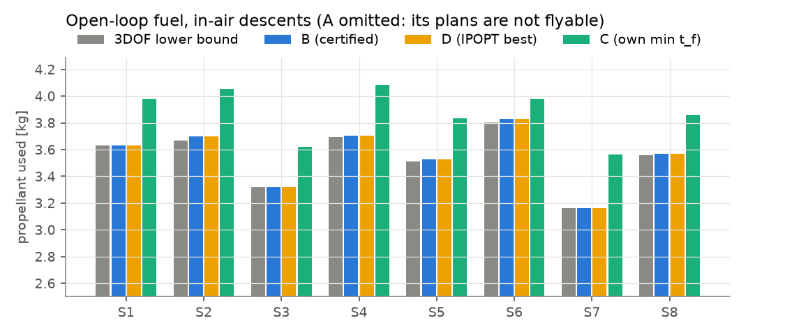
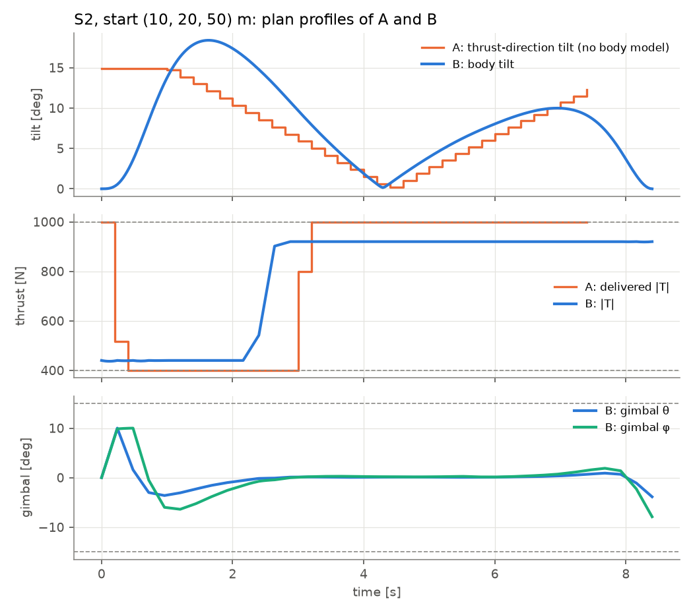
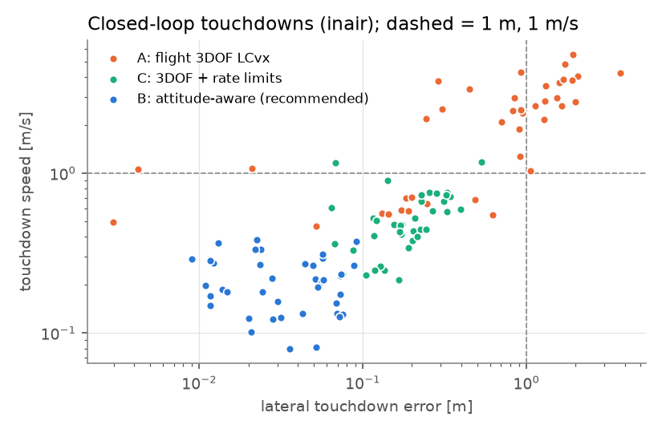

# Results: A vs B vs C vs D (and the 3DOF lower bound)

Generated 2026-11-07 by `scripts/run_openloop.py`, `scripts/run_hop.py`, `scripts/run_montecarlo.py` and
`scripts/make_report.py`. Raw data: `results/*.json`. Machine: development Mac under a load average of about 15–25
(other agents), single-threaded BLAS. Solver times are Clarabel's internal times, i.e. the Rust solver.

**Vehicle:** m₀ ≈ 80 kg, dry 55.88 kg, Isp 180 s, J_t(m) and L(m) from the sim-plant table (63.6 kg m² / 0.589 m wet),
throttle 400–1000 N with 2000 N/s slew, ±15° box gimbal with 100°/s slew, RCS roll.

**Planning constraints, identical for B, C and D:**

- throttle 440–920 N,
- gimbal tan-angle 10°,
- linear gimbal-rate and throttle-rate conditions,
- tilt ≤ 20°,
- glide slope 10° (none for hops),
- touchdown at the pad target (0, 0, 1.5 m) at rest, upright, with zero rate,
- the gimbal starts centred (it cannot jump).

**A** runs the flight code's settings: 400–1000 N, a 15° cone about vertical, v_max = 15 m/s, and its own
shortest-feasible t_f search.

## 1. Open loop: optimality and certificates (8 in-air scenarios)

**t_f** = B's minimum certified time of flight, found by bisection. D is CasADi/IPOPT on the full quaternion rigid
body, N = 35, with 4 starts: B's plan, two perturbed copies of it, and the 3DOF solution.
**LB** = the 3DOF relaxation at the same t_f. It is a lower bound for any flyable plan (claim N7).

| scenario | t_f [s] | LB [kg] | **B** [kg] | D best [kg] | B − D | B − LB | B iterations / SOCPs / solver time [s] | B certificate | C at this t_f | C at its own min t_f |
|---|---|---|---|---|---|---|---|---|---|---|
| S1 vertical, 50 m | 8.37 | 3.6336 | 3.6336 | 3.6336 | +0.000 % | +0.00 % | 1 / 9 / 0.06 | PASS | infeasible | 8.49 s, 3.980 (+9.5 %) |
| S2 (10, 20, 50) at rest | 8.39 | 3.6686 | 3.6999 | 3.6997 | +0.007 % | +0.85 % | 28 / 63 / 1.24 | PASS | infeasible | 8.57 s, 4.051 (+9.5 %) |
| S3 (−8, 5, 45), v (2, −1, −4) | 7.21 | 3.3187 | 3.3195 | 3.3191 | +0.012 % | +0.03 % | 18 / 43 / 0.65 | PASS | infeasible | 7.46 s, 3.620 (+9.0 %) |
| S4 (5, 0, 55), v (−3, 2, −2) | 8.27 | 3.6940 | 3.7053 | 3.7052 | +0.003 % | +0.31 % | 27 / 61 / 0.98 | PASS | infeasible | 8.52 s, 4.082 (+10.2 %) |
| S5 (0, 0, 50), v (4, 0, −5) | 7.52 | 3.5112 | 3.5290 | 3.5289 | +0.002 % | +0.51 % | 25 / 57 / 0.88 | PASS | infeasible | 7.70 s, 3.834 (+8.6 %) |
| S6 (15, −10, 60), v (0, 0, −6) | 8.11 | 3.8019 | 3.8294 | 3.8292 | +0.007 % | +0.72 % | 24 / 55 / 0.96 | PASS | infeasible | 8.36 s, 3.980 (+3.9 %) |
| S7 (−5, −12, 40), v (1, 3, −3) | 6.95 | 3.1636 | 3.1647 | 3.1645 | +0.006 % | +0.04 % | 15 / 37 / 0.58 | PASS | infeasible | 7.20 s, 3.562 (+12.6 %) |
| S8 (20, 0, 50), v (−2, 0, −2) | 7.96 | 3.5579 | 3.5676 | 3.5675 | +0.003 % | +0.27 % | 27 / 61 / 0.98 | PASS | infeasible | 8.21 s, 3.860 (+8.2 %) |

- **B is within 0.012 % of the best IPOPT optimum** (mean 0.005 %). D converged from all 4 starts in all 8 scenarios
  and found nothing better than B. Multistart NLP cannot prove global optimality.
- **The certified gap to the 3DOF lower bound is at most 0.85 % (mean 0.34 %).** So B is provably within 1 % of the
  6DOF optimum at that t_f, up to the bound's discretisation. Rigorous, cheap and instance-wise, this answers "within
  a few % of the nonconvex optimum".
- **Every B plan passed the certificate.** The open-loop replay through the full quaternion 6DOF model lands within
  0.03–0.7 mm and 0.1 mm/s of the target. Peak gimbal 10.0°, peak gimbal rate 58°/s, peak tilt 19.4°.
- **"B0"** (warm start plus one exact inner solve, no attitude iterations) is certified only in the vertical case
  (1/8). The leftover velocity defect is 0.01–4.7 m/s. The attitude iterations are therefore necessary.
- **C (3DOF + rate limits) is infeasible at B's t_f in 8/8 scenarios.** The second-difference limit
  ‖T_{k+1} − 2T_k + T_{k−1}‖ ≤ Δ₂, sized to keep the thrust-direction angular acceleration within the TVC envelope,
  also caps the throttle's second derivative. That rules out the bang-bang throttle profile fuel-optimal descents
  need. C needs 0.12–0.25 s more and then costs +3.9 to +12.6 % fuel versus B at B's minimum t_f.
  At t_f + 0.5 s, C is feasible, tight (‖u‖ = σ at every node) and 0.0–0.4 % cheaper than B. That is only because C
  is a 3DOF plan, not a flyable one (claim C-Y).

At t_f + 0.5 s: B − D ≤ 0.020 %, B − LB ≤ 0.43 %, all certified.

### What baseline A (faithful flight code) does on the same scenarios

| scenario | A t_f [s] | A fuel [kg] | min delivered thrust [N] (limit 400) | lossy nodes (‖u‖ < σ) | thrust tilt at t = 0 / at touchdown | angular accel. to reach the first tilt in one step (h = 0.2 s) |
|---|---|---|---|---|---|---|
| S1 | 7.0 | 3.111 | **296** | 6 | 0.0° / 0.0° | 0 |
| S2 | 7.6 | 3.342 | 400 | 0 | 14.9° / 12.3° | 13 rad/s² |
| S3 | 6.0 | 2.870 | **297** | 7 | 1.0° / 2.6° | 0.9 rad/s² |
| S4 | 7.0 | 3.215 | **305** | 7 | 6.9° / 3.2° | 6.0 rad/s² |
| S5 | 6.6 | 3.127 | 400 | 0 | 14.9° / 7.8° | 13 rad/s² |
| S6 | 7.0 | 3.340 | 400 | 0 | 14.9° / 11.5° | 13 rad/s² |
| S7 | 6.0 | 2.758 | 400 | 0 | 1.5° / 4.5° | 1.3 rad/s² |
| S8 | 7.0 | 3.152 | 400 | 0 | 9.4° / 9.2° | 8.2 rad/s² |

The available pitch/yaw angular acceleration is 0.96 rad/s² (wet, 400 N) to 2.4 rad/s² (1000 N) with the full 15°
gimbal.

A's t_f and fuel look 10–20 % better than B, but its plans are not physically realisable:

1. **3/8 plans are lossy.** They deliver 296–305 N on the "minimum-thrust" arc, below the 400 N minimum, exactly as
   in the repo's stored CSVs and as claim C-E predicts.
2. **Direction jumps.** A asks for an instantaneous thrust-direction jump at t = 0 (body upright, thrust tilted
   15°), which needs 5–14× the available angular acceleration at h = 0.2 s, and about 10³× at the benchmark
   h = 0.0125 s.
3. **Tilted touchdown.** A ends with the thrust tilted by up to 12°, because nothing in A asks for an upright
   touchdown.
4. **Optimistic t_f.** A's shortest-feasible t_f uses the full physical 400–1000 N range with no tracking margin.

## 2. Pad hop: where the nonconvexity is real

Launch from the pad (CG at 1.5 m) with upward speed v0z, and land d metres away after exactly 4 s.

| v0z [m/s] | d = 0 m | d = 2 m | d = 4 m | d = 6 m |
|---|---|---|---|---|
| 5.0 | B ✓ = D ✓ (1.536 kg) | B ✓ = D ✓ | B ✓ = D ✓ | B ✗, D ✗ |
| 5.5 | B ✓ = D ✓ | B ✓ = D ✓ | B ✓ = D ✓ | B ✗, D ✗ |
| 6.0 | B ✓ = D ✓ | B ✓ = D ✓ | B ✓ ≈ D ✓ (+0.3 %) | B ✗, D ✗ |
| 6.5 | B ✗, D ✗ | B ✗, D ✗ | B ✗, D ✗ | B ✗, D ✗ |
| 7.0 | B ✗, D ✗ | B ✗, D ✗ | B ✗, D ✗ | B ✗, D ✗ |

- **The 3DOF relaxation and the flight LCvx (A) report "optimal" in all 20 cells.** For v0z ≥ 6.5 m/s, A's plans
  stay at or above 400 N in most cells, but no flyable pure-TVC plan reaches any of those spots: neither B nor IPOPT
  from two starts finds one.
- The 3DOF problem can waste vertical impulse by instantly re-pointing the thrust sideways; the real vehicle cannot.
  This is the B\*/HOP mechanism (`numerics/README.md` §3) at GTPL planning limits.
- **B and D agree on feasibility in 20/20 cells, and on fuel within 0.3 % where both are feasible.** When no plan
  exists, B returns `infeasible-best-effort`, the plan that minimises the landing defect; its residual is listed in
  `results/hop_map.json`.
- Not proven: "no IPOPT solution" is weak evidence of infeasibility. The SDP lift of math/08 would give a certificate
  but is not implemented here.
- An earlier run without the initial-gimbal condition showed one B stall where IPOPT did find a plan (v0z 5, d 6). With
  the gimbal starting centred, both agree that this cell is infeasible (`results/hop_map_v1.json`).

## 3. Closed-loop 6DOF Monte Carlo

**Plant:**

- rigid body, pure TVC,
- mass-dependent J_t and L,
- gimbal box ±15° with 100°/s slew; throttle 400–1000 N with 2000 N/s slew,
- RCS roll bang-bang,
- wind 0–3 m/s plus gusts (σ = 0.5) acting through drag (CdA 0.2 m²),
- thrust noise 2 %, Isp error σ = 5 %, gimbal misalignment σ = 0.2°.

**Tracking and replanning:**

- one tracker for every method: the CoP-LQR at 50 Hz,
- replans at 1 Hz, stopped when less than 1.5 s remains.

**Times of flight:**

- B: min certified t_f + 0.5 s,
- C: its own min t_f + 0.5 s,
- A: the flight code's own t_f search at every replan.

**Success** means touchdown speed ≤ 1 m/s, lateral error ≤ 1 m and tilt ≤ 5°.

### In-air descents (40 runs)

Initial conditions:

- position x, y ~ U(−15, 15) m, z ~ U(40, 60) m,
- horizontal velocity ~ N(0, 1.5) m/s, vertical velocity ~ U(−6, −1) m/s,
- tilt ≤ 3°, body rate σ = 0.03 rad/s,
- m₀ ~ U(77, 80) kg.

**Landing quality**

| method | success | touchdown speed [m/s] median / p95 / max | lateral error [m] median / p95 / max | tilt at touchdown, p95 | max tilt in flight, p95 |
|---|---|---|---|---|---|
| A flight LCvx | 28 % (11/40) | 2.42 / 4.30 / 5.51 | 0.87 / 2.00 / 3.75 | 4.2° | 24.9° |
| **B** | **100 % (40/40)** | **0.20 / 0.37 / 0.38** | **0.03 / 0.08 / 0.09** | 1.1° | 17.5° |
| C 3DOF + rate limits | 95 % (38/40) | 0.48 / 0.91 / 1.18 | 0.18 / 0.34 / 0.53 | 1.9° | 20.6° |

**Fuel, actuator use and planning cost**

| method | fuel at t_f [kg] | thrust saturated (time) | gimbal saturated (time) | plans passing their certificate | solver time per replan, mean / max [s] |
|---|---|---|---|---|---|
| A flight LCvx | 3.04 | 39.5 % | 7.9 % | 64 % (3DOF checks) | 0.007 / 0.015 |
| **B** | **3.67** | 6.7 % | 0.0 % | **97 %** (full certificate) | 0.37 / 1.33 |
| C 3DOF + rate limits | 3.69 | 0.0 % | 1.5 % | 47 % (3DOF checks) | 0.004 / 0.008 |

- **B:**
  - Every run landed, the worst at 0.38 m/s and 9 cm off.
  - Every flown plan was certified. 3 % of replans were not certified and were not flown; the vehicle kept the
    previous plan.
  - Fuel at t_f averaged 2.6 % above the first plan's prediction (disturbances, Isp error, t_f extensions).
  - 49 % of replans (123/251) needed more than the 4-iteration budget (continuation) or a t_f extension (24/40 runs,
    mean +0.35 s). This is the main cost driver; see PORTING.md §3.
- **A** crashes or lands hard in 72 % of runs.
  - Its plans demand thrust below 400 N and instantaneous re-pointing. The tracker saturates the throttle 40 % of the
    time.
  - Its replans move t_f around: A's lower "fuel" is a shorter flight that ends in a hard landing.
- **C** usually lands, but 2–6× less precisely than B (median 0.48 m/s, 18 cm). Its plans are not dynamically
  consistent, so the tracker absorbs the mismatch. Only 47 % of its plans pass even the 3DOF rate/tightness check.
  Per case its closed-loop fuel was 0.9 % above B's.
- "Fuel to touchdown" (A 3.19, B 3.82, C 3.97 kg) includes the slow final sink from z = 1.5 m (plan end at rest) to
  the 1 cm touchdown threshold. That phase is common to all methods.

### Pad hops (30 runs)

Initial conditions:

- launched from the pad with v0z ~ U(5, 6) m/s and horizontal velocity σ = 0.2 m/s,
- target at a random direction, d ~ U(0, 4) m,
- no glide slope.

**Landing quality**

| method | success | touchdown speed [m/s] median / p95 / max | lateral error [m] median / p95 / max | tilt at touchdown, p95 |
|---|---|---|---|---|
| A flight LCvx | 0 % (0/30) | 2.38 / 3.25 / 3.36 | 0.27 / 2.05 / 2.26 | 15.3° |
| **B** | 97 % (29/30) | 0.41 / 0.61 / 0.66 | 0.03 / 0.06 / 0.06 | 4.7° |
| C | 100 % (30/30) | 0.27 / 0.39 / 0.57 | 0.03 / 0.17 / 0.18 | 3.3° |

**Fuel and planning cost**

| method | fuel at t_f [kg] | plans certified | solver time per replan, mean / max [s] |
|---|---|---|---|
| A flight LCvx | 1.33 | 29 % | 0.002 / 0.004 |
| **B** | **1.56** | 100 % | 0.19 / 0.56 |
| C | 1.91 (+23 %) | 96 % | 0.003 / 0.008 |

- B's one failure (case 12) touched down 0.8 s before the plan ended, tilted 5.2°. The min-fuel plan skims the
  altitude floor z ≥ 1.5 m on its way to the offset spot.
  - This is a problem formulation issue for hops: there is no glide-slope cone, so the plan may run along the
    ground.
  - Fix: add a minimum-clearance or glide-slope corridor that becomes active only near the target.
- C lands all hops but needs a longer t_f (its rate limits throttle the bang-bang profile) and 23 % more fuel.
- A fails every hop: tilted, hard touchdowns.

## 4. Summary for the recommendation

| | A (flight) | B (recommended) | C | D (reference) |
|---|---|---|---|---|
| plan flyable by the TVC vehicle | no (lossy min-thrust arc, direction jumps) | **yes, certified per plan** | no (approximately trackable only, C-Y) | yes, but nonconvex, slow, no certificate of convergence |
| fuel vs 6DOF optimum | not comparable (infeasible plans) | **+0.01 % vs IPOPT; ≤ 0.85 % above a rigorous lower bound** | +4 to +13 % (its own min t_f) | reference |
| closed-loop landing success (in-air / hop) | 28 % / 0 % | **100 % / 97 %** | 95 % / 100 % | — |
| median touchdown speed, in-air | 2.4 m/s | **0.20 m/s** | 0.48 m/s | — |
| solver work per replan | 1 SOCP × t_f scan | 9–60 SOCPs (anytime) | 1 SOCP | IPOPT, 1–3 s per start |
| complexity | existing | about 500 lines of Python (planner + certificate) | about 20 lines on top of A | about 200 lines (CasADi) |

**B is the simplest option that is both certifiably feasible and within a few percent of the optimum.**

- C is simpler, and closed-loop tracking hides much of its inconsistency. But it cannot be certified, it is
  infeasible at fuel-optimal times, and it lands 2–6× less precisely (touchdown speed / lateral error).
- B0 (B without attitude iterations) is not feasible in 7/8 cases.
